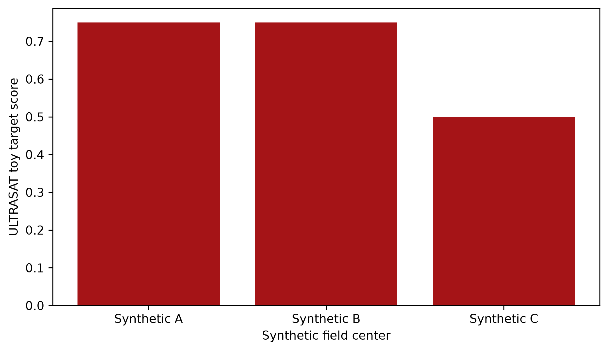

ULTRApipe
=========
How bright will known and candidate exoplanet hosts appear to ULTRASAT in the
near ultraviolet, once stellar color and interstellar dust enter the picture?
And which proposed fields put the most interesting systems in reach? We use
**ULTRApipe** to estimate those magnitudes with color transformations and 3D
dust maps, then compare the exoplanet science potential of proposed pointings.
The repository also collects ULTRASAT throughput and detector limiting- and
saturation-magnitude data, so the instrumental assumptions stay visible. The
`API <https://ultrapipe.readthedocs.io/en/latest/>`_ documents the available
tools.

Set ``ULTRAPIPE_PATH`` to the checkout directory when using the tools from another location. If unset, the tools use this checkout. Keep local inputs in the ignored ``data/`` directory and generated figures in ``visuals/``. Git does not include the derived ``Composite_TOI_Host.csv`` catalog. To reproduce the field map, place it in ``data/`` with columns ``ra``, ``dec``, ``AB_Mag``, ``sy_dist``, ``st_teff``, ``Weight``, and ``Data_Size``.

Here is what the current tools let us do:

+++++++++++++++++++++++++++++++++++++++++++++++++++++++++++++++++++
ULTRASAT near-UV color transformations
+++++++++++++++++++++++++++++++++++++++++++++++++++++++++++++++++++

A plot of the TESS and ULTRASAT magnitudes of stars hosting confirmed exoplanets is below.

.. image:: /media/graphics/TESS_to_ULTRASAT_Mag.png
  :width: 400
  :alt: Histogram of the TESS/ULTRASAT magnitude of known or PC exoplanetary systems.

++++++++++++++++++++++++++++++
Predicting ULTRASAT magnitudes
++++++++++++++++++++++++++++++
.. image:: /media/graphics/Dust_Map.png
  :width: 800
  :alt: Near-UV dust extinction from Pan-STARRS 1, 2MASS, and Gaia for declinations above -30 degrees at several distances.

We estimate ULTRASAT magnitudes from stellar color transformations and dust
extinction, using the 3D dust map derived from Pan-STARRS 1, 2MASS, and Gaia
`Green et al. 2019 <http://argonaut.rc.fas.harvard.edu/>`_. The maps show how
near-ultraviolet extinction changes with distance for declinations above -30
degrees.

++++++++++++++++++++++++++++++++++++++++++++++++++++++++++++++++++++++++
Ranking proposed ULTRASAT fields for exoplanet science
++++++++++++++++++++++++++++++++++++++++++++++++++++++++++++++++++++++++

.. image:: /media/graphics/Cost_Function.png
  :width: 800
  :alt: A cost map of known and candidate TOI systems across proposed 7-by-7-degree continuous-viewing zones.

We use known and candidate exoplanets to make a first-pass map of the science
potential across proposed ULTRASAT fields. The map's weights and
parameterization are in `utils.py`.

We measure target offsets with Astropy's spherical angular separation, including
right-ascension wraparound and both poles. The field radius describes a circular
on-sky approximation. Exact detector footprints are not modeled by this score.
We have not regenerated the displayed maps for this geometry correction.

+++++++++++++++++++++++++++++++++++
ULTRASAT Systematics and Throughput
+++++++++++++++++++++++++++++++++++

Several useful data files are also hosted here, detailing the throughput of ULTRASAT over its passband, as well as the limiting and saturation magnitudes of different radial positions on the detector for different colored targets.

++++++++++++++++++++++
Generating the Figures
++++++++++++++++++++++
To generate the above figures, we can use ``utils.dust_map()`` and ``utils.cost_function_map()`` in tandem with ``utils.Plot_Cartesian_Sky_Map()``.

All that is needed are the relevant data lists for your targets:

.. code-block:: python
    
    import utils as ut
    from paths import get_data_path, get_repository_path, get_visuals_path
    import pandas as pd
    data = pd.read_csv(get_data_path() / 'Composite_TOI_Host.csv')
    ra = data['ra']
    dec = data['dec']
    AB = data['AB_Mag']
    dist = data['sy_dist']
    Teff = data['st_teff']
    weight = data['Weight']
    data_size = data['Data_Size']
    SAT_Mag_dir = get_repository_path() / 'systematics' / 'SatMag.csv'
    LIM_Mag_dir = get_repository_path() / 'systematics' / 'LimMag.csv'

To plot the cost function:

.. code-block:: python

    CF_Map = ut.cost_function_map(ra, dec, AB, dist, Teff, weight, data_size, SAT_Mag_dir, LIM_Mag_dir, radius = 7, output_dir=None, 
                                resolution = 15, dust_map_version='bayestar2019')
    ut.Plot_Cartesian_Sky_Map(CF_Map, output_path=get_visuals_path() / 'ultrasat_exoplanet_field_cost.png')

To plot the dust map(s):

.. code-block:: python

    dust_map = ut.dust_map(100, dist = 500)
    ut.Plot_Cartesian_Sky_Map(dust_map)

Offline synthetic example
-------------------------

The `synthetic field-ranking notebook <examples/synthetic_field_ranking.ipynb>`_
passes six toy targets through ``utils.cost_function()`` for three trial field
centers, using the tracked saturation and limiting-magnitude tables. Zero
reddening keeps the example offline. It saves a static PNG and, with Bokeh
installed, a hoverable HTML chart under ``examples/visuals/``. The six targets
are synthetic, and the notebook does not query Bayestar. The scores illustrate
pipeline behavior and do not guide real pointings. Install Bokeh with
``python -m pip install bokeh`` for the interactive chart.

The `interactive Bokeh chart <examples/visuals/ultrapipe_synthetic_field_scores.html>`_
shows each field's RA, Dec, and toy score on hover.
